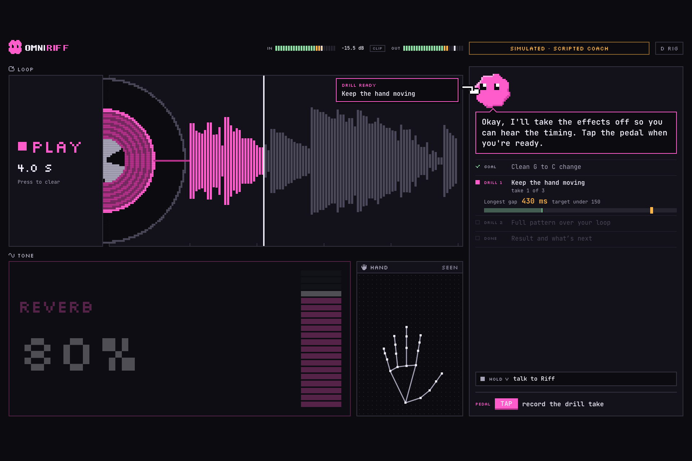
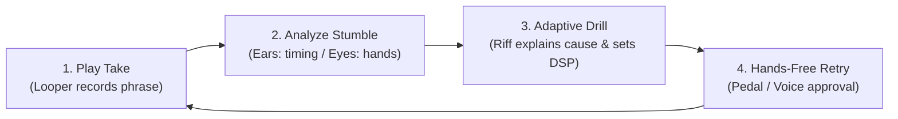
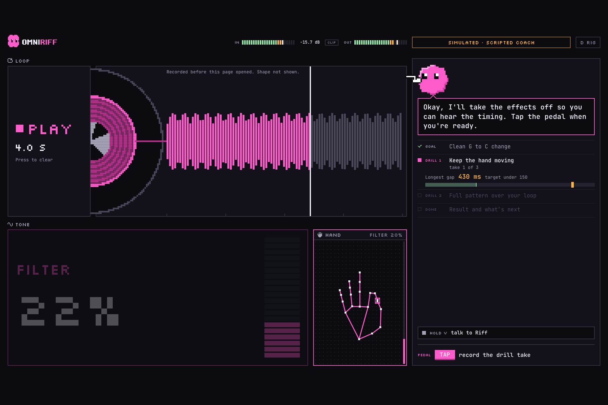
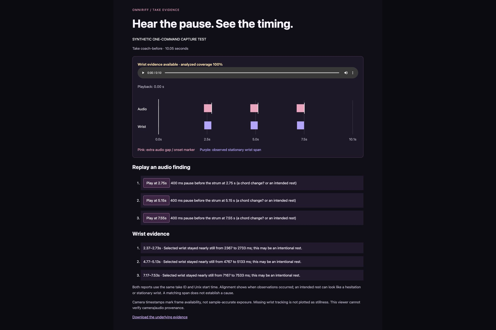
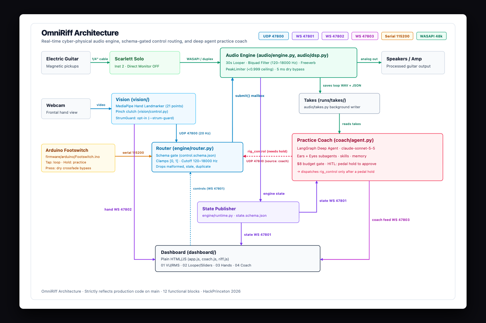

<p align="center">
  <picture>
    <source media="(prefers-color-scheme: light)" srcset="dashboard/brand/logo-animated-light.gif">
    
  </picture>
</p>

# OmniRiff

[](https://omniriff.vercel.app/)
[](https://github.com/angelofernand0/omniriff/actions)
[](https://github.com/angelofernand0/omniriff/actions)
[](https://developers.google.com/mediapipe)
[](firmware/README.md)

> **OmniRiff is an AI guitar teacher that lives in your signal chain.**  
> It hears your phrasing through high-resolution audio DI, watches your hands through standard camera video, pinpoints exactly *why* you stumbled, and walks you through the fix—without ever forcing you to put your guitar down.

---

## 🚀 Experience OmniRiff

* **Play Online Right Now:** [**https://omniriff.vercel.app**](https://omniriff.vercel.app/)
  * **Browser Simulator:** Zero-install instant rig. Generated guitar loops and simulated hand gestures run 100% in your browser without hardware or accounts.
  * **Live Audio + Camera:** Plug in your electric guitar via any USB audio interface (e.g. Focusrite Scarlett Solo) and use your laptop or USB webcam for live, real-time gesture shaping.
* **Team Passcode for Hosted Coach:** Available privately to hackathon judges to unlock live conversational AI coaching sessions powered by LangChain Deep Agents.

---

<p align="center">
  
  <br>
  <em>The OmniRiff Practice Dashboard: live signal meters, real-time waveform looping, adaptive practice checklist, and AI Coach Riff proposing a targeted drill based on acoustic timing hesitation.</em>
</p>

---

## 🎯 The Practice Loop: From Stumble to Progress

Conventional guitar apps score *that* you missed a note, but leave you guessing *why*. OmniRiff creates a continuous cyber-physical learning feedback loop:



1. **Play a Take:** Record a phrase with the built-in looper while your guitar audio flows through the real-time DSP engine with ultra-low latency.
2. **Find the Root Cause:**
   * **Ears:** High-precision audio onset and beat-tracking algorithms detect hesitation gaps and tempo drift.
   * **Eyes:** Computer vision detects picking stalls and hand freezes during chord transitions.
3. **Target the Fix:** **Riff**, the conversational AI coach, reviews the multimodal evidence and prescribes one focused exercise (e.g., speed chunking, transition smoothing, or rhythmic subdivision) rather than generic scores.
4. **Approve & Retry Hands-Free:** Riff adjusts the looper speed or effects chain for the drill. The player confirms via a momentary foot tap or voice command (`V` key or pedal hold), never taking their hands off the fretboard.

---

## ✨ Core Innovations & Capabilities

### 1. 🎸 Web Audio & Real-Time DSP Signal Chain
* **AudioWorklet Architecture:** Dedicated audio render thread runs completely decoupled from UI rendering, camera inference, and network traffic.
* **Click-Free DSP Suite:**
  * **Dynamic Biquad Lowpass Filter:** Smooth resonance and sweep modulation.
  * **Studio Reverb:** Algorithmic spatial reverberation with rich decay.
  * **30-Second Looper:** Instant phrase capture, playback, and seamless overdubbing.
  * **Equal-Power Bypass:** Crossfades smoothly to 100% dry guitar signal with zero pops or clicks.
* **Pro Audio Routing:** Explicit input channel selection (Channel 2 instrument DI) and hardware output destination routing via Web Audio `setSinkId()` (route to interface monitors, headphones, or system speakers).

### 2. 🤖 Conversational AI Coach ("Riff")
* **LangChain Deep Agent Engine:** Stateful agent analyzing take recordings and persistent practice memory across sessions.
* **Push-to-Talk Voice Interaction:** Speak directly to Riff using the `V` key or by holding down the physical USB foot pedal.
* **Dynamic Speech Synthesis:** Riff speaks conversational coaching replies aloud via `speechSynthesis` or ElevenLabs neural TTS.
* **Safety Isolation:** The AI coach works **between takes**, never inside the real-time audio callback. Audio continues uninterrupted even if network drops or the coach process closes.

### 3. 👁️ Optical Strum Guard & Vision Gestures
* **Google MediaPipe Hand Landmarker:** High-speed 21-landmark tracking running at 30+ FPS.
* **Strict Right-Hand Gating:** The vision engine strictly ignores the left hand on the guitar neck and frets, eliminating spurious control jumps while playing chords.
* **Dorsal (Back-of-Hand) Rejection:** Uses the 2D cross-product of the palm axis vector (wrist $\to$ middle knuckle) and the knuckle line (index $\to$ pinky) to detect hand orientation. When strumming with a pick (back of hand facing camera), all pinches and fists are rejected to prevent accidental parameter shifts.
* **Kinematic Strum Guard:** Flags rapid rhythmic velocity reversals in $y$ ($> 0.35\text{ units/sec}$) and suppresses gestures within the lower guitar strumming zone ($y \ge 0.52$).
* **Deliberate Air Gestures:** Raising the right hand into the air ($y < 0.50$) with the palm facing forward arms the clutch:
  * **Pinch & Elevation Sweep:** Grabs and modulates the active filter or reverb depth.
  * **Closed Fist Swap:** Swaps active modulation between Filter and Reverb with bright green knuckle HUD feedback.

### 4. 🎛️ Physical Arduino USB Serial Pedal
* **Custom Debounced Firmware:** Runs on Arduino Uno / Nano at 115200 baud with hardware pull-ups and 25 ms debouncing (`firmware/arduino/Footswitch/Footswitch.ino`).
* **Web Serial API Integration:** Browser connects directly to the USB serial pedal with zero native driver installation.
* **Multimodal Action Mapping:**
  * **Short Tap (Loop Switch):** Record / Stop / Play loop take.
  * **Short Tap (Bypass Switch):** Instant dry signal bypass toggle.
  * **Long Press (Hold Switch):** Push-to-talk voice conversation with Coach Riff or drill approval.

---

## 📸 System Showcase

<p align="center">
  
  <br>
  <em>Gesture Control View: real-time 21-point hand tracking with pinch elevation sweep controlling filter resonance, active bypass state, and live input meters.</em>
</p>

<p align="center">
  
  <br>
  <em>Multimodal Evidence Timeline: automated alignment between acoustic timing hesitation detected by Ears and stationary hand intervals detected by Eyes.</em>
</p>

<p align="center">
  
  <br>
  <em>Cyber-Physical Architecture: independent dual-sensor input (DI guitar audio + camera frames), schema-validated control router, real-time DSP engine, and LangChain Deep Agent coach.</em>
</p>

---

## 🛠️ Getting Started & Local Development

### Prerequisites
* **Node.js:** v22.12 or newer
* **Python:** v3.9 or newer (for native local engine and offline tools)
* **Hardware (Optional):** Electric guitar, Focusrite Scarlett Solo (or compatible USB interface), Arduino Uno / Nano footswitch, webcam.

### 1. Browser App (TypeScript & Vite)
```bash
git clone https://github.com/angelofernand0/omniriff.git
cd omniriff

# Install dependencies
npm ci --ignore-scripts

# Run type check and browser test suite (95 tests)
npm run typecheck
npm test

# Launch local dev server
npm run dev
```
Open `http://localhost:5173` to play immediately in your browser.

### 2. Native Engine & Python Suite (Optional)
```bash
# Setup virtual environment
python3 -m venv .venv
source .venv/bin/activate  # Windows: .venv\Scripts\activate

# Install development dependencies
pip install -r requirements-dev.txt

# Run Python unit & integration test suite (517 tests)
python -m unittest discover -s tests -p 'test_*.py'

# Run hardware preflight diagnostics
python -m engine --check
```

### 3. Arduino Footswitch Setup
1. Open `firmware/arduino/Footswitch/Footswitch.ino` in the Arduino IDE.
2. Select your board (Arduino Uno / Nano) and upload the sketch.
3. Plug in the USB cable and click **Connect USB Pedal** in OmniRiff's browser settings.

---

## 🛡️ Reliability & Verification

* **Unit & Integration Tests:**
  * **95 Browser Tests (Vitest):** Full coverage across AudioWorklet DSP, Web Serial packet handling, MediaPipe hand selection, StrumGuard kinematics, and coach communication.
  * **517 Python Tests (unittest):** Strict testing of audio DSP math, looper buffer bounds, state machine transitions, JSON Schema contracts, and fail-safe recovery.
* **Fail-Safe Decoupling:**
  * Severing the webcam cable or killing the vision process leaves guitar audio running cleanly.
  * Unplugging the USB serial footswitch defaults gracefully to keyboard shortcuts (`L` for loop, `B` for bypass, `V` for voice).
  * Web Audio and Python engines both enforce click-free digital crossfading on bypass.

---

## 👥 The OmniRiff Team

* **John Saleh** ([@lsj3l](https://github.com/lsj3l)) — Computer Vision (MediaPipe 21-landmark tracking, Right-hand gating, Back-of-hand orientation rejection, StrumGuard), Web Serial pedal adapter, Audio Output selector.
* **Angelo Fernando** ([@angelofernand0](https://github.com/angelofernand0)) — Team Lead, Real-time Audio DSP Engine, Shared Protocol Contracts, CI/CD and deployment pipeline.
* **SM (Seanmanuel)** ([@smcogburn](https://github.com/smcogburn)) — Dashboard Architecture, LangChain Deep Agent Coach brain, Voice interface & Brand design.
* **Aditya** ([@MonkeySeeMonkeyC0de](https://github.com/MonkeySeeMonkeyC0de)) — Hardware Engineering, Arduino Footswitch firmware, electrical debouncing, and physical rig bring-up.

---

## 📄 License & Attribution

* Built for **HackPrinceton Fall '26**.
* Uses Google MediaPipe for hand landmark inference.
* Board coordination helper adapted from `azizu06/hackathon-agent-board`.
* SIL Open Font License typography (JetBrains Mono & Silkscreen).
