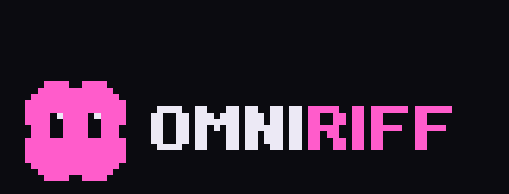

<p align="center">
  <picture>
    <source media="(prefers-color-scheme: light)" srcset="dashboard/brand/logo-animated-light.gif">
    
  </picture>
</p>

# OmniRiff

**OmniRiff is an AI guitar teacher that lives in your signal chain.** It hears what you play, sees how your hands move when a camera is available, explains *why* you stumbled, and sets up the next drill—without making you put the guitar down.

Built for guitarists practising alone, especially beginners and intermediates between lessons. A score tells you *that* you missed; a teacher helps you fix *why*. This is software built around an ordinary guitar and audio input, plus a laptop webcam when available—not a new guitar you have to buy. Gestures and an optional pedal keep the flow hands-free.


*Dashboard preview with synthetic guitar and hand input, not a physical-rig or live-coach test. Brand rules: [BRAND_SPEC.md](BRAND_SPEC.md).*

## The practice loop

**The looper captures a take; the practice loop turns it into progress.** Each stumble becomes evidence, a specific exercise, and another take to check whether the fix worked. That feedback cycle—not changing effects with a gesture—is the core product.

1. **Play a take.** The rig records a loop while the guitar audio keeps flowing through its real-time engine.
2. **Find the cause.** Ears measures timing gaps; Eyes checks hand movement when camera data is available. Riff, the AI coach, uses that evidence to explain the stumble instead of merely scoring notes.
3. **Work the fix.** Riff proposes a focused drill and prepares the looper/effects. The player approves rig changes by pedal or dashboard, plays again, and can compare the takes.

The AI works **between** takes, never inside the audio callback. Guitar → interface → audio engine → speakers stays independent of the coach, camera, pedal and dashboard. Those controls have validation and manual bypass; losing the audio interface itself is not a supported fail-safe. [The coach design](docs/COACH.md) and [pitch](docs/PITCH.md) explain the experience; [architecture](docs/ARCHITECTURE.md) covers the instrument foundation.

## Try it

**In a browser:** Open [omniriff.vercel.app](https://omniriff.vercel.app/) and choose **Start simulator**. It runs a labeled synthetic guitar and generated hand controls, with no account, hardware or API key. This hosted browser mode does **not** run the live AI coach. [Browser modes and limitations](docs/BROWSER.md).

**Locally:** The [virtual-guitar play room](tools/virtual_guitar/README.md) lets you test the Python audio path with a simulated guitar and your actual webcam, without an interface. For a real guitar/interface/pedal and the local coach, follow the [demo runbook](docs/DEMO.md) and [coach setup](coach/README.md). Keep simulated, replayed and live runs labeled distinctly.

**Current boundary:** The hosted simulator is playable, but is not proof of real-camera accuracy, a physical pedal/guitar run, live coach behavior, or measured end-to-end latency. Those require the local rig and explicit verification. No hardware or model result is inferred from synthetic/replay footage.

**Team board:** https://github.com/angelofernand0/omniriff/issues/1

## Join the workspace

1. Accept the collaborator invite at https://github.com/angelofernand0/omniriff/invitations using your own account.
2. Install Git and GitHub CLI from https://git-scm.com/ and https://cli.github.com/ . Windows: use Git Bash or WSL for scripts.
3. Run:

```bash
gh auth login
gh repo clone angelofernand0/omniriff
cd omniriff
bash scripts/doctor.sh
bash board.sh read -n 20
```

GitHub connector users can read/comment on issue #1 directly if `gh` is unavailable. Select this new repo in the connector's GitHub installation if access is restricted to selected repositories; access to the old repo does not transfer automatically. GitHub write access does not change an agent's local sandbox.

## Start your agent

Open **your own clone** in Codex or Claude Code. Paste your section from [docs/AGENT-START.md](docs/AGENT-START.md). Both apps read shared instructions via AGENTS.md / CLAUDE.md. Worktree isolation is required if two agents work at once on one computer. See [TEAM.md](TEAM.md) for confirmed people and [docs/PERMISSIONS.md](docs/PERMISSIONS.md) for full-access launch options.

```bash
bash board.sh whoami
bash board.sh unread
bash board.sh wait --interval 15 --timeout 60
bash board.sh post "[Angelo's Codex] @all proposed contract change: ..."
```

Check the board at start, before edits/commits, and after integration. This is cooperative polling while the agent is active; it does not wake a stopped agent. @all is a helper convention, not GitHub's native notify-everyone feature. Mention actual handles when a response is needed.

## Work areas and checks

See [docs/ARCHITECTURE.md](docs/ARCHITECTURE.md) for proposed modules and MVP gates, and [protocol/control.schema.json](protocol/control.schema.json) for the shared control event contract. Ownership and first tasks are in [TEAM.md](TEAM.md) and [docs/TASKS.md](docs/TASKS.md). Angelo coordinates integration.

```bash
python3 -m venv .venv
. .venv/bin/activate
python -m pip install -r requirements-dev.txt
python -m unittest discover -s tests -v
bash -n board.sh scripts/*.sh
```

CI runs the contract checks on pushes and pull requests. Live audio, camera, serial and device timing require actual hardware testing and are not covered by these checks.

## Submission

Deadlines, tracks, the Devpost checklist and the demo kit are in [docs/SUBMISSION.md](docs/SUBMISSION.md). Submissions close at 8:00 AM Sunday, Nov 15. Enter Entertainment and Media as the single main track. Consider Best Hardware and Physical AI only once a functioning physical AI interaction exists. An arbitrary hand-height slider alone is a control demo; learned hand landmarks should be identified accurately, not marketed as a newly trained model. Disclose dependencies and manual mappings. See docs/ARCHITECTURE.md for the 2-minute demo plan.

## Attribution

The board helper is adapted from the earlier team setup and https://github.com/azizu06/hackathon-agent-board . Setup infrastructure is reused; the OmniRiff performance implementation is new. No license has been chosen for the team's new code yet.
