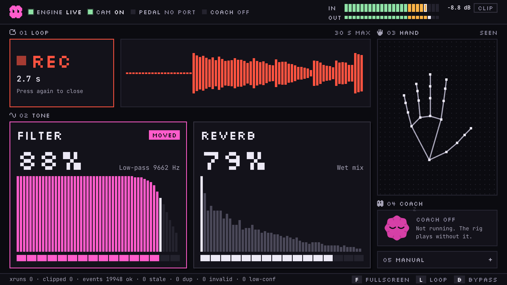

# OmniRiff

**Never put the guitar down.** OmniRiff lets a guitarist shape their sound with a pinch of the hand and a tap of the foot, live, without taking their hands off the strings. HackPrinceton Fall 2026.



*The dashboard running on the simulator (synthetic guitar and a scripted hand, no hardware). Brand rules: [BRAND_SPEC.md](BRAND_SPEC.md).*

**Team board:** https://github.com/angelofernand0/omniriff/issues/1

## What it does

Guitar → Focusrite Scarlett Solo → laptop audio engine (filter sweep, reverb, looper, bypass, limiter) → speakers.
- **Hand:** a pretrained MediaPipe hand-landmark model; pinch to engage, raise or lower to sweep (`vision/`).
- **Foot:** an Arduino footswitch for loop and bypass (`firmware/arduino/`).
- **Screen:** a live dashboard with levels, loop, effects, sensor health and the hand skeleton (`dashboard/`).
- **Coach (in progress):** a practice coach that hears takes and sees the hand between performances (`docs/COACH.md`).

Every input can fail without stopping the music. Unsafe, stale or low-confidence controls never reach the audio.

## Try it

```bash
python -m pip install -r engine/requirements.txt -r vision/requirements.txt
python -m tools.sim run --demo                  # no hardware: simulated rig + dashboard at http://127.0.0.1:8080
python -m engine --check                        # on the demo laptop: preflight
python -m engine.demo --open --vision --vision-args "--model models/hand_landmarker.task" \
  --in Focusrite --out Focusrite --hostapi WASAPI --input-channel 2 --serial-port COM3
```

The full bring-up and 2-minute demo are in [docs/DEMO.md](docs/DEMO.md). Module details: [audio/](audio/README.md), [engine/](engine/README.md), [vision/](vision/README.md), [dashboard/](dashboard/README.md), [tools/](tools/).

**Status:** software is complete and tested in CI (simulated and recorded inputs). The live Windows laptop + Scarlett + camera + pedal run happens Saturday night. Latency and gesture rates are reported only once measured (`tools/latency`).

## Join the workspace

1. Accept the collaborator invite at https://github.com/angelofernand0/omniriff/invitations using your own account.
2. Install Git and GitHub CLI from https://git-scm.com/ and https://cli.github.com/ . Windows: use Git Bash or WSL for scripts.
3. Run:

```bash
gh auth login
gh repo clone angelofernand0/omniriff
cd omniriff
bash scripts/doctor.sh
bash board.sh read -n 20
```

GitHub connector users can read/comment on issue #1 directly if `gh` is unavailable. Select this new repo in the connector's GitHub installation if access is restricted to selected repositories; access to the old repo does not transfer automatically. GitHub write access does not change an agent's local sandbox.

## Start your agent

Open **your own clone** in Codex or Claude Code. Paste your section from [docs/AGENT-START.md](docs/AGENT-START.md). Both apps read shared instructions via AGENTS.md / CLAUDE.md. Worktree isolation is required if two agents work at once on one computer. See [TEAM.md](TEAM.md) for confirmed people and [docs/PERMISSIONS.md](docs/PERMISSIONS.md) for full-access launch options.

```bash
bash board.sh whoami
bash board.sh unread
bash board.sh wait --interval 15 --timeout 60
bash board.sh post "[Angelo's Codex] @all proposed contract change: ..."
```

Check the board at start, before edits/commits, and after integration. This is cooperative polling while the agent is active; it does not wake a stopped agent. @all is a helper convention, not GitHub's native notify-everyone feature. Mention actual handles when a response is needed.

## Work areas and checks

See [docs/ARCHITECTURE.md](docs/ARCHITECTURE.md) for proposed modules and MVP gates, and [protocol/control.schema.json](protocol/control.schema.json) for the shared control event contract. Ownership and first tasks are in [TEAM.md](TEAM.md) and [docs/TASKS.md](docs/TASKS.md). Angelo coordinates integration.

```bash
python3 -m venv .venv
. .venv/bin/activate
python -m pip install -r requirements-dev.txt
python -m unittest discover -s tests -v
bash -n board.sh scripts/*.sh
```

CI runs the contract checks on pushes and pull requests. Live audio, camera, serial and device timing require actual hardware testing and are not covered by these checks.

## Submission

Deadlines, tracks, the Devpost checklist and the demo kit are in [docs/SUBMISSION.md](docs/SUBMISSION.md). Submissions close at 8:00 AM Sunday, Nov 15. Enter Entertainment and Media as the single main track. Consider Best Hardware and Physical AI only once a functioning physical AI interaction exists. An arbitrary hand-height slider alone is a control demo; learned hand landmarks should be identified accurately, not marketed as a newly trained model. Disclose dependencies and manual mappings. See docs/ARCHITECTURE.md for the 2-minute demo plan.

## Attribution

The board helper is adapted from the earlier team setup and https://github.com/azizu06/hackathon-agent-board . Setup infrastructure is reused; the OmniRiff performance implementation is new. No license has been chosen for the team's new code yet.
