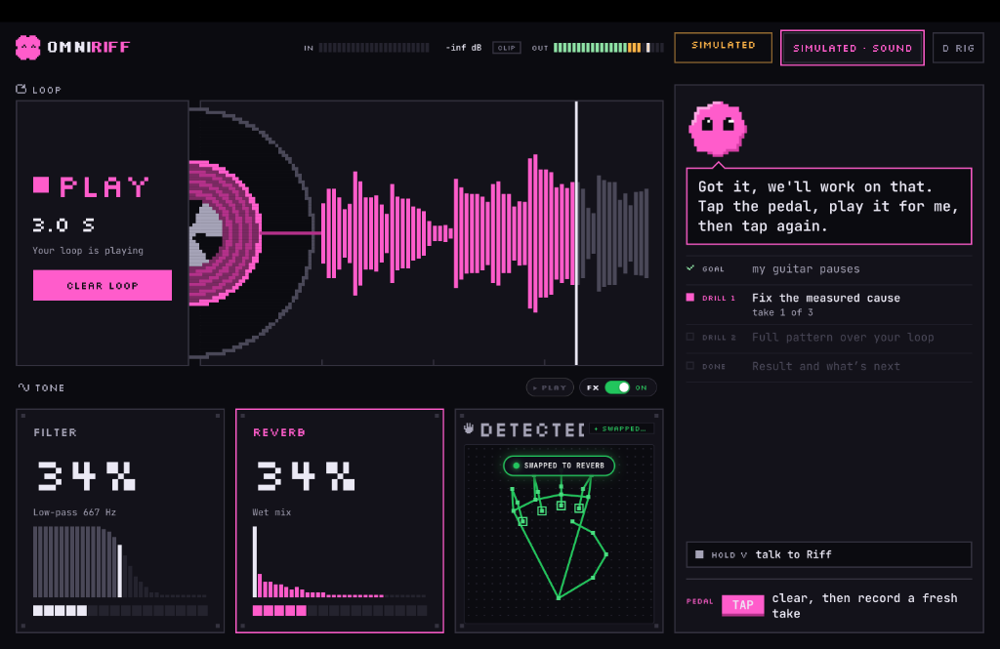
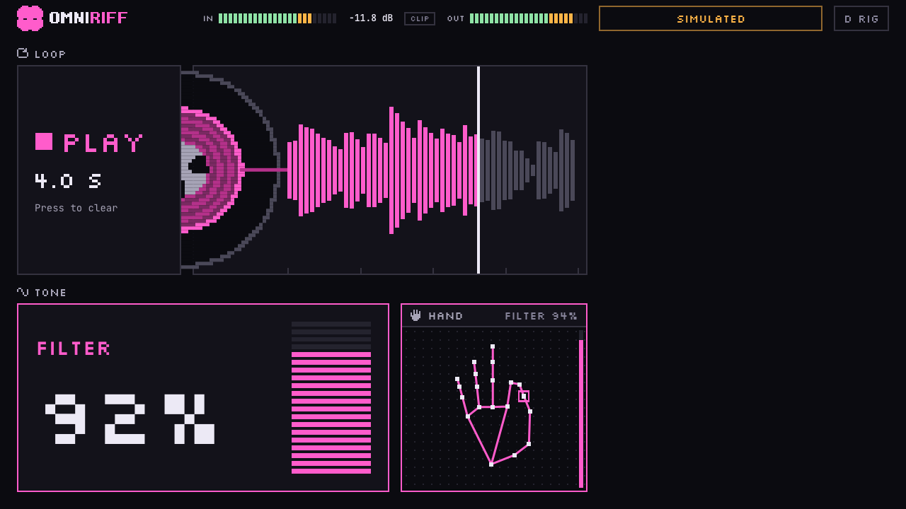
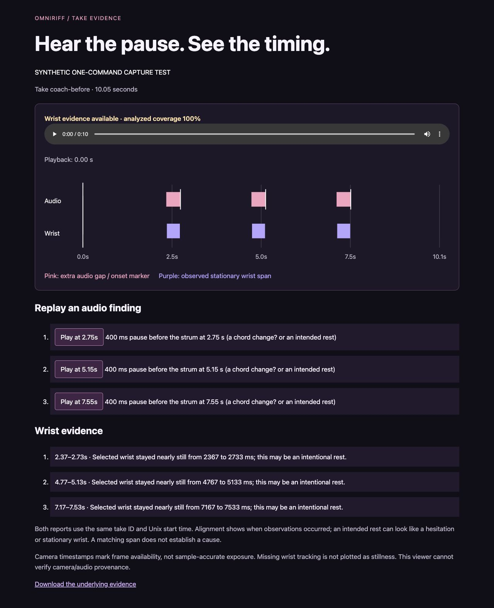

# Devpost gallery

Three actual browser captures from main `2f8f4cf`, captured November 14, 2026 (US Eastern). Use these captions with the images. All inputs shown are synthetic. These images document software behavior, not live guitar, webcam accuracy, hardware latency, or a measured learning outcome.

## 1. Practice dashboard



**Caption:** The OmniRiff practice dashboard brings loop playback, active tone DSP, gesture knuckle tracking, and Riff's coaching guidance together. This live session capture shows Riff proposing Drill 1 ("Fix the measured cause") in response to player timing pauses, with active loop playback, simulated tone toggle (`▶ PLAY`), and knuckle gesture tracking confirming a parameter swap (`SWAPPED TO REVERB`).

The `SIMULATED · SOUND` badge is visible alongside active looper controls, voice coaching (`HOLD V talk to Riff`), and pedal tap shortcuts.

## 2. Gesture control view



**Caption:** Generated hand landmarks exercise the gesture-control display, showing an engaged hand driving the filter sweep (`FILTER 67%`) alongside an active coach session. This is a synthetic hand feed, not webcam detection.

The `SIMULATED · SCRIPTED COACH` badge remains in frame. `tools/sim/hand.py` generates the 21 hand points; `tools/sim/demo.py` sends the matching control sweep through the running engine. The hand's requested value and the engine's smoothed value may differ slightly while moving.

## 3. Take evidence timeline



**Caption:** The Ears and Eyes analyzers align three planted 400 ms extra audio gaps with observed wrist-stillness spans. All guitar and hand data are synthetic fixtures.

The source label is `SYNTHETIC ONE-COMMAND CAPTURE TEST`. The analyzer reports extra gaps before onsets at 2.75, 5.15 and 7.55 seconds and three 366 ms stationary wrist spans. The rounded coverage display reads 100% (the report is 0.9983). Alignment does not establish a cause; intended rests can produce these observations. These reports are produced by the real analyzers and are independent of the scripted dashboard's gap values.

## Capture setup

From a checkout at the revision above, with project dependencies installed:

```bash
python -m tools.sim run --demo --coach-sim --no-voice --duration 300 \
  --udp-port 59210 --ws-port 59211 --hand-port 59212 \
  --coach-port 59213 --http-port 18985
```

Open the dashboard with the isolated endpoints:

```text
http://127.0.0.1:18985/?ws=ws://127.0.0.1:59211&hand=ws://127.0.0.1:59212&coachws=ws://127.0.0.1:59213&sim=input
```

Capture during the scripted session's drill proposal or pass cue. `Y` starts another round after the script finishes. For the gesture image, capture during the active filter sweep in the repeating 16-second demo with the coach session active. No paid model or voice calls are needed. Alternatively, run `python scripts/recapture_gallery.py`.

Recreate the evidence page in a new output directory:

```bash
python -m coach.fixtures.generate --out /tmp/omniriff-gallery-fixtures
python -m vision.evidence \
  --take /tmp/omniriff-gallery-fixtures/coach-before.wav \
  --hand-log /tmp/omniriff-gallery-fixtures/coach-before.hands.jsonl \
  --label 'SYNTHETIC ONE-COMMAND CAPTURE TEST' \
  --output /tmp/omniriff-gallery-evidence
python -m http.server 18986 --bind 127.0.0.1 --directory /tmp/omniriff-gallery-evidence
```

Open `http://127.0.0.1:18986/` and capture the full page. Evidence export refuses to overwrite an existing output directory.

Gallery 01 and 02 were captured through the browser at 1920 × 1080 viewport (full-page evidence: 1280 × 1574). Browser captures were saved directly as RGB PNGs; no content was retouched or composited. No private recording or raw webcam frame is included. A fourth rehearsal image is omitted because a live-camera rehearsal was not available in this capture session.
